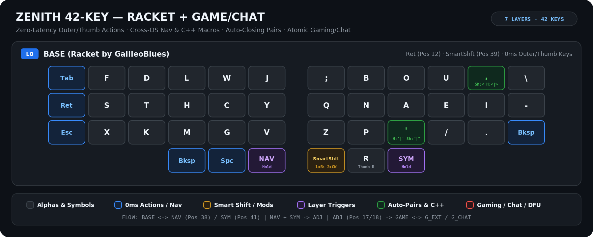
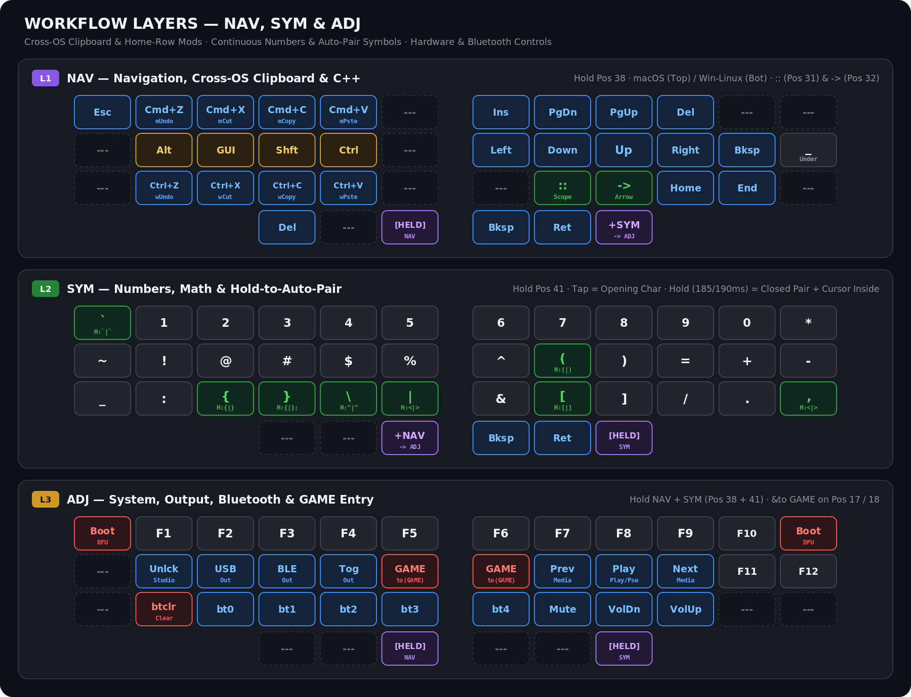
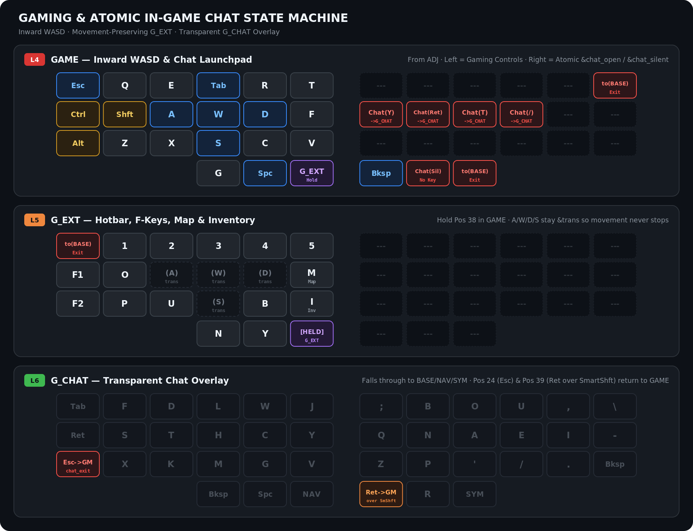

# Zenith 42-Key ZMK Configuration

> **Racket** (by GalileoBlues) keymap with zero-latency outer/thumb actions, cross-OS navigation, hold-to-auto-close programming pairs, and an atomic gaming + in-game chat state machine.

## Overview

A 7-layer **ZMK Firmware** configuration for a **42-key split column-staggered keyboard** (`3x6` matrix + `3` thumb keys per half) with **ZMK Studio** enabled (`CONFIG_ZMK_STUDIO=y`).

| Setting | Value |
| :--- | :--- |
| **Board / Shield** | `seeeduino_xiao_ble` / `zenith_left` |
| **Keymap / Config** | `config/zenith.keymap`, `config/zenith.conf` |
| **Base Layout** | **Racket** (thumb letter `R` on Pos 40) |
| **Layers (`0–6`)** | `BASE`, `NAV`, `SYM`, `ADJ`, `GAME`, `G_EXT`, `G_CHAT` |

---

## Layer Architecture

| # | Layer | Trigger | Focus |
| :--- | :--- | :--- | :--- |
| **0** | `BASE` | Default | Racket alphas, 0ms outer/thumb actions, `SmartShft`, `SmartComma`, `SmartQuote` |
| **1** | `NAV` | Hold Pos 38 | Cross-OS clipboard (`macOS` / `Win-Linux`), home-row mods, arrows, C++ `::` and `->` |
| **2** | `SYM` | Hold Pos 41 | Numbers `1–0`, math/code symbols, and 8 hold-to-auto-pair triggers |
| **3** | `ADJ` | `NAV` + `SYM` | `F1–F12`, `&studio_unlock`, USB/BLE output, BT profiles `0–4`, media, `&to GAME` |
| **4** | `GAME` | `ADJ` Pos 17 / 18 | Inward WASD left half + right-hand atomic chat launchpad |
| **5** | `G_EXT` | Hold Pos 38 in `GAME` | Hotbar `1–5`, `F1/F2`, Map (`M`), Inventory (`I`), transparent `A/W/D/S` |
| **6** | `G_CHAT` | `&chat_open` / `&chat_silent` | Transparent passthrough to `BASE`/`NAV`/`SYM`; exits to `GAME` on `ESC` or `RET` |

---

## Workflow Layers (`NAV`, `SYM`, `ADJ`)

* **Zero-Latency Outer & Thumb Keys (`BASE`):** `TAB` (Pos 00), `RET` (Pos 12), `ESC` (Pos 24), `BSLH` (Pos 11), `MINUS` (Pos 23), `BSPC` (Pos 35 & 36), and `SPACE` (Pos 37) are pure `&kp` bindings with 0ms delay and native hold-to-repeat. Standard modifiers (`Alt`, `GUI`, `Shft`, `Ctrl`) live on the `NAV` home row (Pos 13–16).
* **Smart Shift & Caps Word (`BASE` Pos 39):** `smart_shft` (`mod-morph`) activates **Sticky Shift** (`&sk LSHFT`) on the first tap and morphs into **Caps Word** (`&caps_word`) on a second tap while Shift is active.
* **Cross-OS Clipboard & C++ Operators (`NAV`):** Top row Pos 01–04 sends macOS shortcuts (`Cmd+Z/X/C/V`), bottom row Pos 25–28 sends Windows/Linux shortcuts (`Ctrl+Z/X/C/V`), and Pos 31–32 send `::` (`cpp_scp`) and `->` (`cpp_arr`).

---

## Auto-Closing Pairs & Behavior Tunings

Holding an opening delimiter past its tapping term runs a macro (`wait-ms = <10>`, `tap-ms = <10>`) that inserts the closing character and moves the cursor inside.

| Binding | Position | Tap | Hold (Cursor Inside) | Term / Quick-Tap |
| :--- | :--- | :--- | :--- | :--- |
| `&smart_comma` | `BASE` Pos 10 | `,` (Shift: `<`) | `,` (Shift: `<>`) | `190ms` / `150ms` |
| `&smart_sqt` | `BASE` Pos 32 | `'` (Shift: `"`) | `''` (Shift: `""`) | `190ms` / `150ms` |
| `&ht_grv 0 GRAVE` | `SYM` Pos 00 | Backtick | Double backticks (`pair_grv`) | `185ms` / `150ms` |
| `&ht_par 0 LPAR` | `SYM` Pos 19 | `(` | `()` | `185ms` / `150ms` |
| `&ht_brc 0 LBRC` | `SYM` Pos 26 | `{` | `{}` | `185ms` / `150ms` |
| `&ht_brc_semi 0 RBRC` | `SYM` Pos 27 | `}` | `{};` (cursor 2 left) | `185ms` / `150ms` |
| `&ht_dqt 0 BSLH` | `SYM` Pos 28 | `\` | `""` | `190ms` / `150ms` |
| `&ht_ang 0 PIPE` | `SYM` Pos 29 | Pipe (`\|`) | `<>` | `190ms` / `150ms` |
| `&ht_bkt 0 LBKT` | `SYM` Pos 31 | `[` | `[]` | `185ms` / `150ms` |
| `&ht_ang 0 COMMA` | `SYM` Pos 35 | `,` | `<>` | `190ms` / `150ms` |

### Global Behavior Settings

| Behavior | Configuration |
| :--- | :--- |
| **`&mt`** | `tap-preferred` · `tapping-term-ms = <200>` · `quick-tap-ms = <175>` · `require-prior-idle-ms = <125>` |
| **`&lt`** | `balanced` · `tapping-term-ms = <200>` · `quick-tap-ms = <175>` |
| **`&sk`** | `release-after-ms = <1000>` · `quick-release` · `/delete-property/ ignore-modifiers` |
| **`&caps_word`** | `continue-list = <UNDERSCORE MINUS BSPC DEL N1 N2 N3 N4 N5 N6 N7 N8 N9 N0>` |

> **ZMK `quick-release` Workaround:** Because `&sk` enables `quick-release`, `pair_ang` and `pair_dqt` prepend `<&macro_tap &none>` before releasing Shift and switching back to `&macro_tap` mode, avoiding ZMK's sticky-key + hold-tap + macro interaction (Issue #3279) and preventing Shift from selecting text on the final `LEFT` arrow.

---

## Gaming & Atomic Chat State Machine (`GAME`, `G_EXT`, `G_CHAT`)

* **`GAME` (`Layer 4`):** Entered via `&to GAME` on `ADJ` (Pos 17 or 18). Maps inward WASD (`A/W/D/S` at Pos 14/15/16/27) on the left half and an atomic chat launchpad on the right (`Y`, `RET`, `T`, `/` via `&chat_open`, silent typing mode via `&chat_silent` at Pos 40, and `&to BASE` exits at Pos 11 and 41).
* **`G_EXT` (`Layer 5`):** Held on Pos 38 in `GAME` for hotbar `1–5`, `F1/F2`, `M` (Map), and `I` (Inventory). `A/W/D/S` stay `&trans` so movement continues uninterrupted.
* **`G_CHAT` (`Layer 6`):** Entered from `GAME` chat triggers, passing all keys through to `BASE`/`NAV`/`SYM` until `ESC` (Pos 24) or `RET` (Pos 39) runs `&chat_exit` to return atomically to `GAME`.

> **Keymap Note (`G_CHAT` Pos 39):** After swapping `RET` to Pos 12 and `SmartShft` to Pos 39 on `BASE`, `G_CHAT` currently still intercepts `&chat_exit RET` at Pos 39 (over `BASE` `SmartShft`) rather than Pos 12.

---

## Full Reference Sheet

A single **8.5" × 22"** vertical reference covering all 7 layers and behavior notes is available in [`zenith_all_layers_cheatsheet-v3.png`](./zenith_all_layers_cheatsheet-v3.png).
